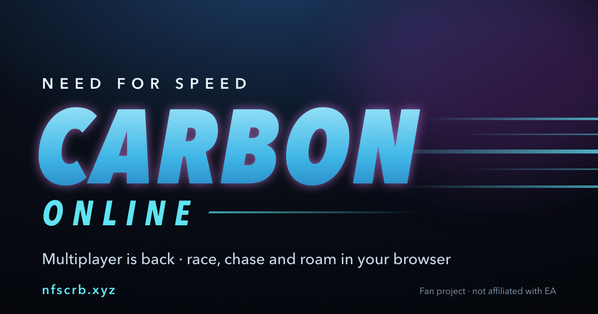

<div align="center">

# NFS Carbon · Browser Edition

**Palmont City. Your browser. Your crew.**

[Play now](https://nfscrb.xyz) · [What's new](CHANGELOG.md) · [Report an issue](https://github.com/metinjakupi/nfs-crb/issues)



</div>

Need for Speed: Carbon running in the browser, with free-roam multiplayer and the game's original online races brought back to life.

The browser runtime uses WebAssembly and WebGPU. A Rust server connects players, hosts online races, and provides friends, chat, and cloud saves.

## Get behind the wheel

Open **[nfscrb.xyz](https://nfscrb.xyz)** in desktop Chrome or Edge with hardware acceleration enabled. Choose your player name, enable online play if you want company, and press **Play**.

For races with friends, choose **Online → Custom Match** inside the game. For free roam, use the same room name on the homepage.

## What you can do

| Feature | In the game |
| --- | --- |
| **Explore together** | Drive through free roam with friends, their customized cars, and map markers. |
| **Race together** | Sprint, Circuit, Speedtrap, Canyon Duel, Pursuit Tag, and Pursuit Knockout. |
| **Stay connected** | Crews, friend requests, invitations, quick chat, and typed messages. |
| **See the action** | Synchronized steering, lights, wheel spin, braking, nitrous, and engine revs. |
| **Keep your progress** | Local saves, backup and restore, and optional cloud saves. |
| **Make it comfortable** | Keyboard and controller support, graphics settings, and an in-game settings menu. |

### Useful keys

| Key | Action |
| --- | --- |
| **F9 / F10** | Open settings |
| **Shift + Y** | Type an online message |
| **Y** | Open quick chat |
| **H** | Hold to sound the horn |
| **F** | Flash headlights |

Driving controls can be changed in the game's **Options → Controls** menu.

## Development

This repository contains the port, browser interface, development tools, and server source. Original game files and generated game builds are not included. Building locally requires your own compatible PC installation of Carbon 1.4.

### Repository map

| Directory | Purpose |
| --- | --- |
| [`source/web/`](source/web/) | Homepage, online interface, chat, settings, and saves |
| [`source/mods/core/nfsc/`](source/mods/core/nfsc/) | Carbon-specific gameplay and compatibility changes |
| [`source/kit/`](source/kit/) | Recompiler, runtime, graphics, audio, and browser platform support |
| [`source/tools/`](source/tools/) | Game setup, analysis, and build tools |
| [`server/`](server/) | Rust multiplayer server |
| [`tools/`](tools/) | Browser tooling, asset preparation, and checks |

### Build the browser runtime

The development workflow requires Python 3, CMake, Ninja, the Emscripten SDK, and the game-analysis tools. The existing setup workflow was developed on macOS.

1. Clone this repository and prepare your game installation using the setup, DLL rebasing, and analysis steps in [the source setup guide](source/README.md#build-it-by-hand-for-development). Run those steps from `source/`; skip the native app packaging step for a browser build.
2. Activate your Emscripten SDK, then build from `source/`:

   ```sh
   source /path/to/emsdk/emsdk_env.sh
   .venv/bin/python tools/build.py --target web --regenerate
   ```

3. From the repository root, create and serve a local launcher:

   ```sh
   python3 source/kit/tools/web_launcher.py \
     --game-dir source \
     --out source/build/local-site \
     --web-build nfsc=source/build/web/recomp \
     --serve 8000
   ```

4. Open `http://localhost:8000` and import your game files through the launcher.

Use the included server rather than a basic file server: the game needs browser isolation headers to run its worker threads.

### Run the multiplayer server

```sh
cd server
cargo run --release -- 8001 127.0.0.1
```

See [the server guide](server/README.md) for online race hosting, persistence, and configuration.

## Bugs and contributions

Found a problem? Use **Send report** in the game, or [open an issue](https://github.com/metinjakupi/nfs-crb/issues) with your browser, operating system, graphics card, and steps to reproduce it. Do not attach game files, saves, or credentials to a public issue.

Focused fixes and reproducible reports are welcome. Check [the changelog](CHANGELOG.md) for recent fixes and known limitations. Hardware-specific graphics failures and online edge cases are still being investigated.

## Credits

This project builds on work from:

- [vasist15-source](https://github.com/vasist15-source/nfs-carbon-mac) — the Carbon Mac port.
- [veritr1x](https://github.com/veritr1x/recomp-kit) — recomp-kit.
- [elforeign](https://github.com/elforeign/nfs-most-wanted-mac) — the Most Wanted Mac port.
- [ThirteenAG](https://github.com/ThirteenAG/WidescreenFixesPack) — widescreen improvements.
- [th0mk](https://github.com/th0mk/nfsu2-web), with Talha Müderrisoğlu — the Underground 2 browser work and online foundations.
- [Lovro Pleše and Berkay Yiğit](https://github.com/xan1242/NFS-XtendedInput) — controller support.
- [MaxHwoy / nlgxzef](https://github.com/nlgxzef/Darius) — Endscript and Darius tooling.

See [the port licence](source/LICENSE), [port credits and notices](source/NOTICE), [recomp-kit licence](source/kit/LICENSE), and [server notices](server/NOTICE) for attribution and terms.

This is a fan project, not affiliated with or endorsed by Electronic Arts. Need for Speed and Carbon are trademarks of Electronic Arts Inc. Original game materials retain their original ownership.
